# 🥙 Pideci Sitesi | Online Sipariş ve Restoran Yönetimi

[](README_EN.md)
[](https://github.com/fathylmaz/pideci-fullstack/actions/workflows/ci.yml)

**Pideci Sitesi**, taş fırın restoranları için geliştirilen, müşterilerin ürünleri inceleyip sipariş oluşturabildiği ve işletmenin menüsünü, fiyatlarını, stoklarını ve siparişlerini tek panelden yönetebildiği **full-stack restoran yönetim ve online sipariş uygulamasıdır**. Kırmızı-beyaz görsel kimliği korunarak mobil ve masaüstü ekranlar için geliştirilmiştir.

> **Proje durumu:** Yerel ortamda test edilmiş portföy/pilot uygulamasıdır; ticari kullanım için üretim ortamı, güvenlik, gizlilik ve operasyon kontrolleri gerektirir. Ödeme yöntemi kapıda nakittir; online kartla ödeme bulunmaz.

## 🚀 Özellikler

**Müşteri arayüzü**
- 6 kategoride 45 örnek ürün; ürün fotoğrafları, arama, filtreleme, sıralama, kampanyalar ve öne çıkan lezzetler
- Sepete ekleme/çıkarma, adet değiştirme; fiyatların ve toplam tutarın sunucu tarafında hesaplanması
- Sipariş formu, asgari sipariş tutarı, teslimat ücreti ve isteğe bağlı teslimat bölgesi kontrolü
- Sipariş kodu ve siparişte kullanılan telefon numarasıyla durum sorgulama
- İletişim formu, işletme bilgileri ve sosyal medya bağlantıları

**Yönetici paneli**
- Kurulumda belirlenen şifreyle yönetici girişi; hazır yönetici şifresi bulunmaz
- Ürün, kategori, fiyat, indirim, stok, rozet ve görsel yönetimi
- Gelen siparişleri görüntüleme, sipariş durumunu değiştirme ve CSV çıktısı
- İşletme bilgileri, ana sayfa görselleri, teslimat bölgeleri ve sipariş alımı ayarları
- Yönetici paneli açıkken isteğe bağlı tarayıcı bildirimleri

## 🛠️ Kullanılan Teknolojiler

| Katman | Teknolojiler |
|---|---|
| Backend | Python, FastAPI, SQLAlchemy, Pydantic |
| Veritabanı | SQLite |
| Frontend | HTML, CSS, JavaScript |
| Test ve CI | Pytest, GitHub Actions |
| Görsel işleme | Pillow |

## 💻 Windows'ta Kurulum

```powershell
git clone https://github.com/fathylmaz/pideci-fullstack.git
cd pideci-fullstack
.\KURULUM_WINDOWS.bat
.\BASLAT_WINDOWS.bat
```

İlk kurulum yönetici şifresi oluşturulmasını ister (en az 12 karakter). **Varsayılan şifre yoktur.** Daha önce kurulmuş bir uygulamada ilk kurulum komutunu yeniden çalıştırmayın.

- **Müşteri sitesi:** http://127.0.0.1:8000
- **Yönetici paneli:** http://127.0.0.1:8000/admin

## ✅ Testler

```powershell
.\.venv\Scripts\python.exe -m pip install -r requirements-dev.txt
.\.venv\Scripts\python.exe -m pytest -q
node --check web\js\site.js
node --check web\js\admin.js
```

Projede API ve iş kurallarına yönelik otomatik testler bulunur. GitHub Actions üzerinden Python testleri ve JavaScript sözdizimi kontrolleri çalıştırılır.

## 🔐 Güvenlik ve Yayın Notları

`.env`, `data/`, `backups/`, müşteri kayıtları, yönetici şifreleri ve kişisel bilgi içeren ekran görüntüleri GitHub'a eklenmemelidir. İşletmede gerçek kullanım öncesinde HTTPS, gizlilik/KVKK süreçleri, yedek geri yükleme, izleme, bildirim güvenilirliği ve ek güvenlik testleri gerekir.

📖 [Ayrıntılı Türkçe kurulum ve kullanım rehberi](README_TR.md) · [Yayın öncesi kontrol listesi](docs/YAYIN_ONCESI_KONTROL_TR.md) · [Değişiklik geçmişi](CHANGELOG.md)

<!-- PIDECI_GALLERY_V1 -->

---

## 📸 Ekran Görüntüleri

### Müşteri Arayüzü

| Ana Sayfa | Ürün Menüsü |
|:---:|:---:|
|  | 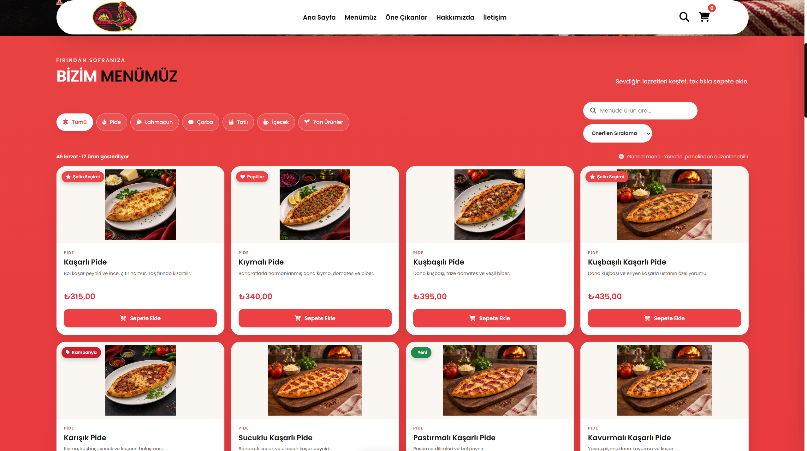 |

| Öne Çıkan Lezzetler | Sepet |
|:---:|:---:|
| 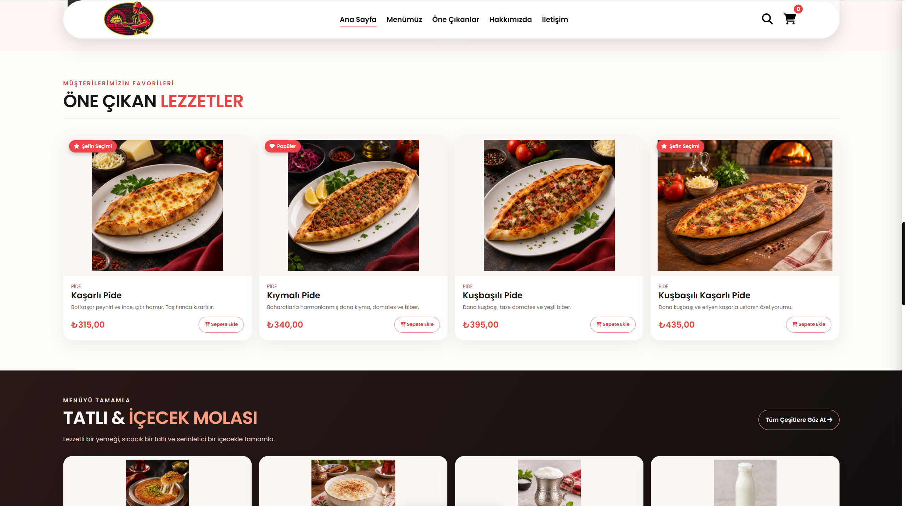 | 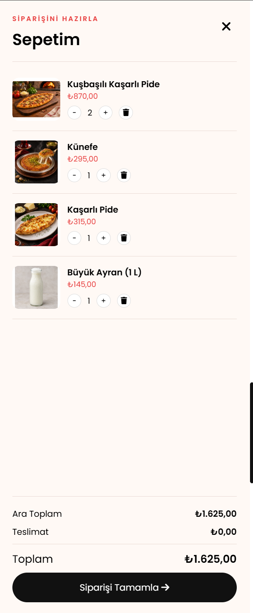 |

| Sipariş Formu | Sipariş Takibi |
|:---:|:---:|
| 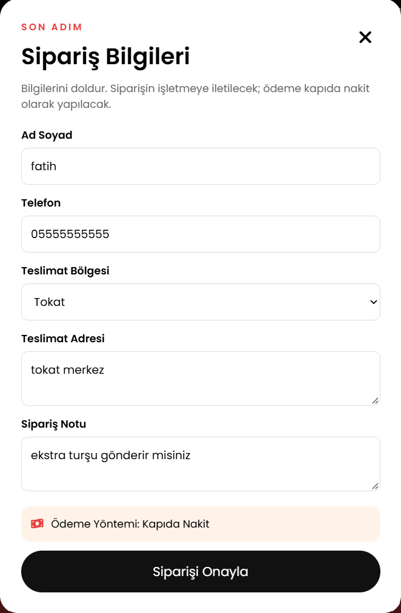 | 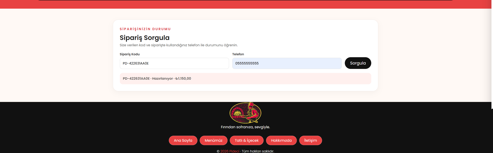 |

### Yönetici Paneli

| Genel Bakış | Ürün Yönetimi |
|:---:|:---:|
| 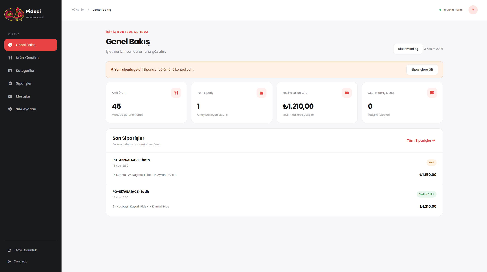 | 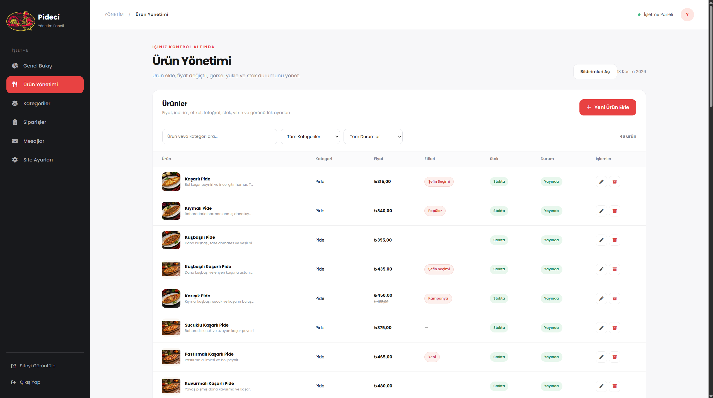 |

| Ürün Düzenleme | Sipariş Yönetimi |
|:---:|:---:|
| 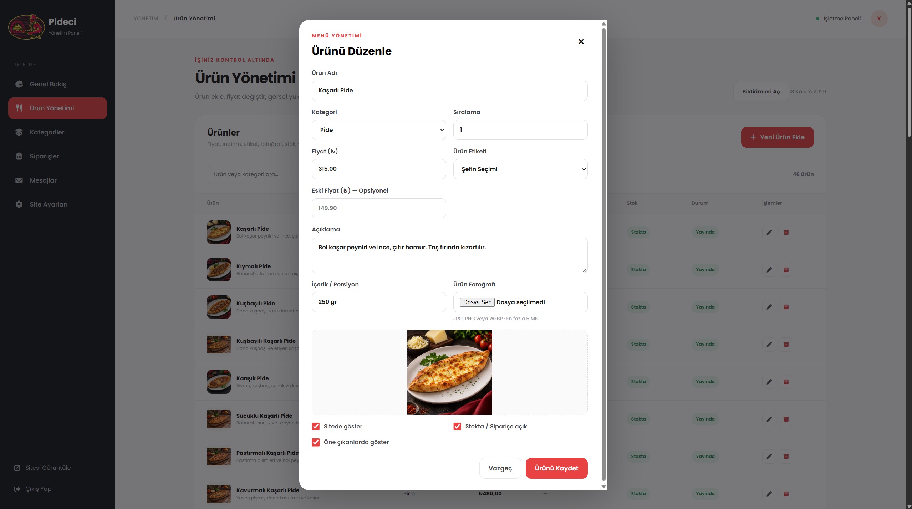 | 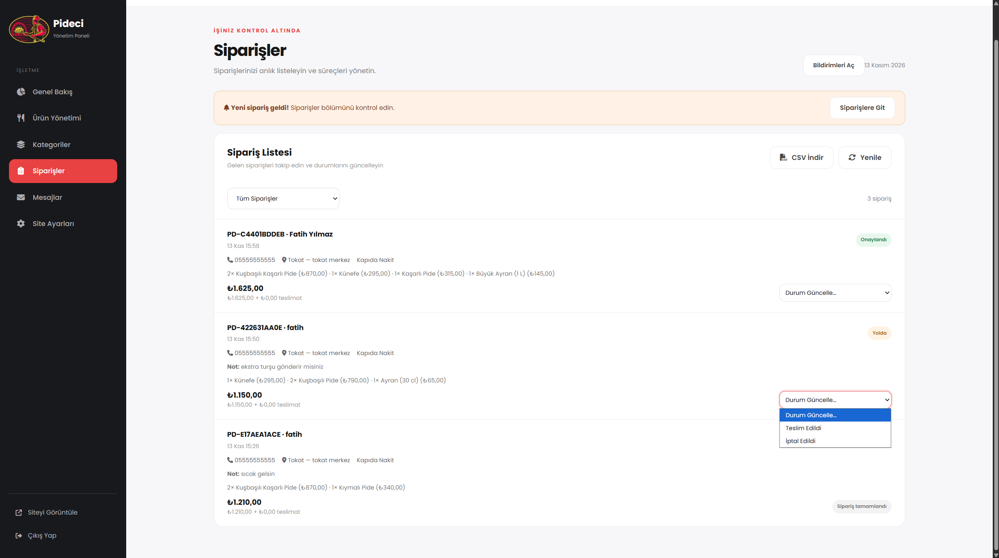 |

**İşletme Ayarları**

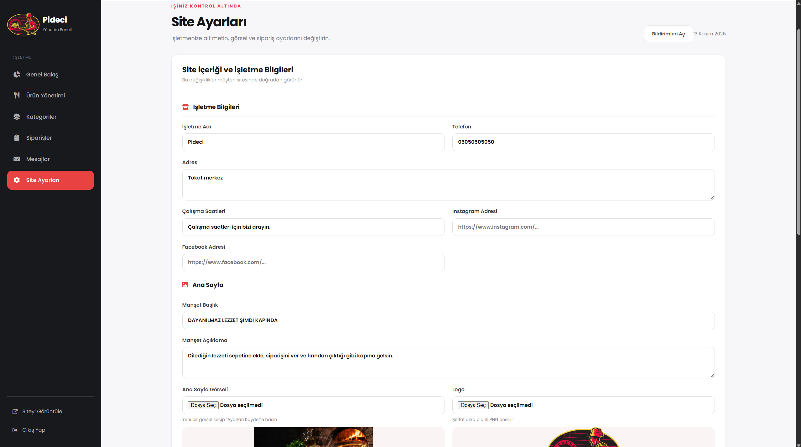

### Mobil Arayüz

| Mobil Ana Sayfa | Mobil Menü | Mobil Sepet |
|:---:|:---:|:---:|
|  | 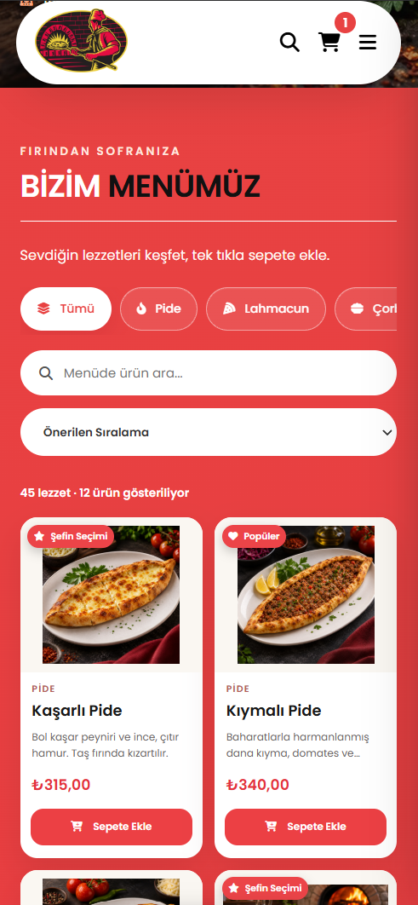 | 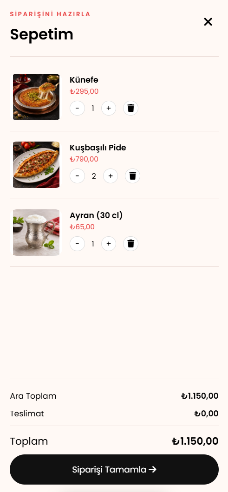 |

<!-- PIDECI_GALLERY_END -->
