# Pideci | Restaurant Ordering & Management

[](README.md)
[](https://github.com/fathylmaz/pideci-fullstack/actions/workflows/ci.yml)

A full-stack restaurant ordering demo built around the original red/black/white theme. **This is a local pilot**, not a payment-certified, production-ready platform.

## Tech
Python 3.13, FastAPI, SQLAlchemy, Pydantic, SQLite, HTML/CSS, vanilla JavaScript, Pillow, Pytest and GitHub Actions.

## Customer website
- Browse 45 seed products across pide, lahmacun, soups, desserts, drinks and extras; filter/sort/search.
- View featured dishes, badges, promotions and availability.
- Add/remove cart items, enforce quantity limits; server computes authoritative totals.
- Submit name, phone, delivery address, optional service area and order note; cash on delivery only.
- Receive an order code and check its status using that code **and** the ordering phone number.
- Send a contact message; view restaurant's hours, address, phone and social links.

## Admin dashboard
- Session-based administrator login with CSRF checks (credentials configured at install time).
- Create/edit/archive products, upload product photographs, manage prices, categories, badges and stock.
- Review incoming orders, advance order status, export CSV and see dashboard KPIs.
- View customer messages, configure logos, hero and about section, fees/minimums, delivery areas, hours and Instagram/Facebook.
- Optional browser notifications while the panel is running and visible; not a reliable push-notification service.

## Windows installation

```powershell
cd "C:\VS CODE PROJE\Pideci-Sitesi"
.\KURULUM_WINDOWS.bat
.\BASLAT_WINDOWS.bat
```

Open http://127.0.0.1:8000 or http://127.0.0.1:8000/admin. First-time setup prompts for an admin password (minimum 12 characters). There is **no preset password**. On an existing installation, do **not** rerun initial setup; use the versioned patch installer.

## Automated testing

```powershell
.\.venv\Scripts\python.exe -m pip install -r requirements-dev.txt
.\.venv\Scripts\python.exe -m pytest -q
```

Tests use disposable databases. The GitHub Actions workflow runs the same API checks and syntax validation of both JavaScript applications.

## Persistent data & safety
Database: `data/pideci.db`; admin-uploaded media: `data/uploads`. Back up both with `scripts/backup_database.py`; ZIP backups contain private customer information and **must not** be public. User-defined prices and admin credentials are persisted in SQLite and are not overwritten by normal upgrades.

Before deploying publicly: configure HTTPS, secure cookies, privacy notice/consent and data retention, verified restorations, production monitoring, a suitable database and backups, customer/order notifications, as well as legal and security review. See [prelaunch checklist](docs/YAYIN_ONCESI_KONTROL_TR.md).

**Do not commit:** database files, `.env` secrets, private backup ZIPs, uploaded customer data, local virtual environments, unredacted screenshots.

---

<!-- PIDECI_GALLERY_V1 -->

---

## 📸 Screenshots | Ekran Görüntüleri

### Customer Experience | Müşteri Arayüzü

| Homepage | Product Menu |
|:---:|:---:|
| 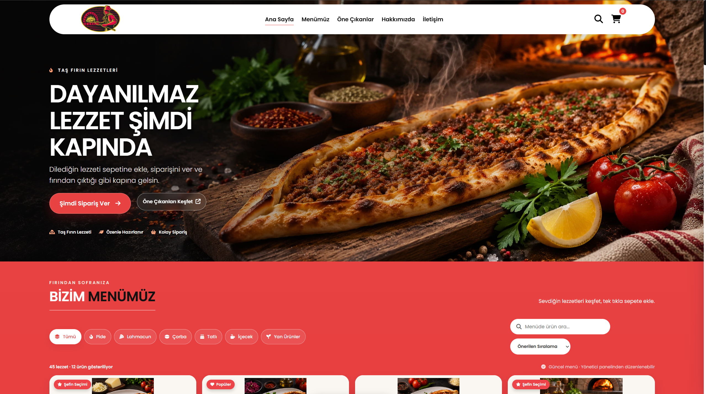 | 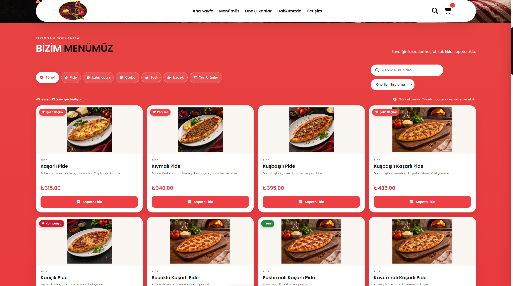 |

| Featured Products | Shopping Cart |
|:---:|:---:|
| 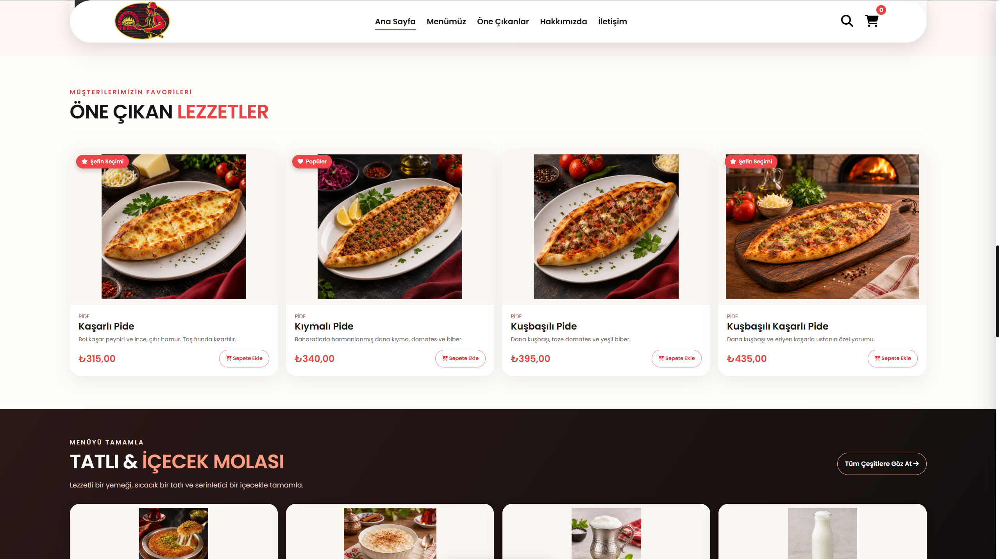 | 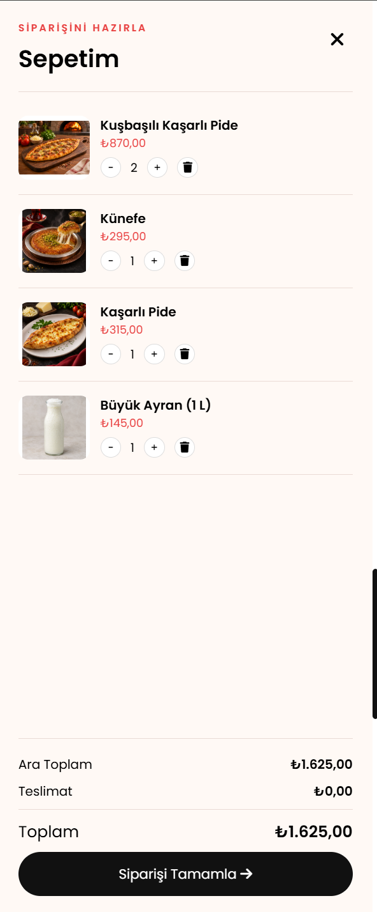 |

| Checkout | Order Tracking |
|:---:|:---:|
| 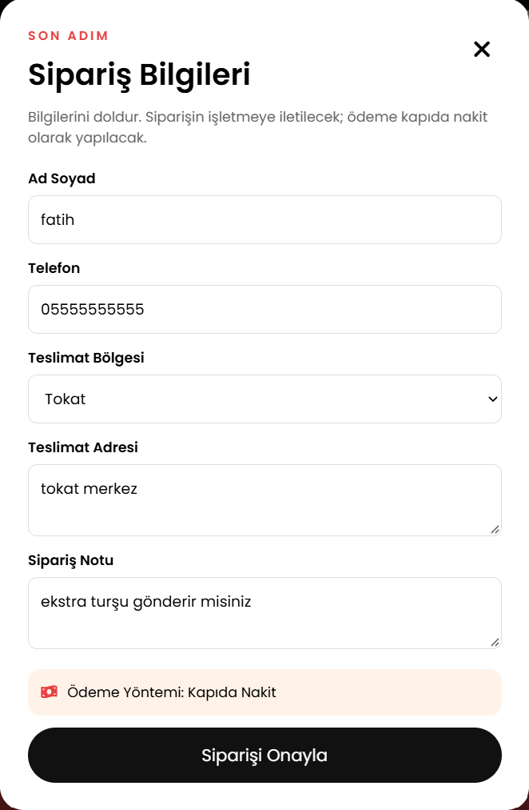 | 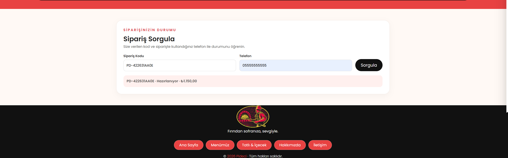 |

### Admin Dashboard | Yönetici Paneli

| Dashboard | Product Management |
|:---:|:---:|
| 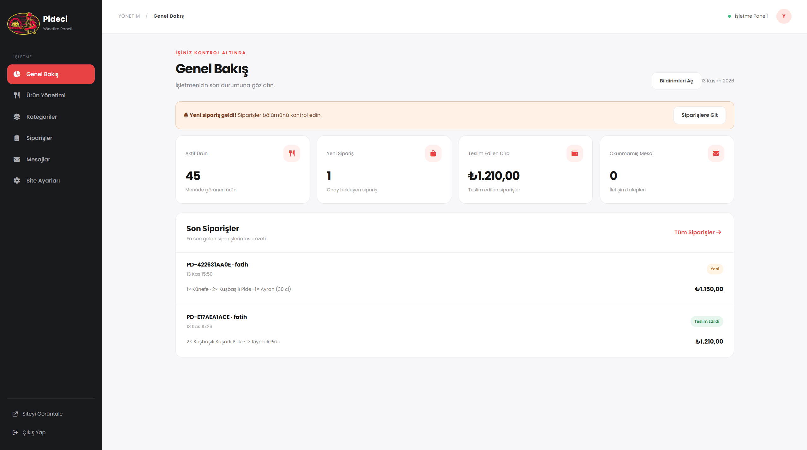 | 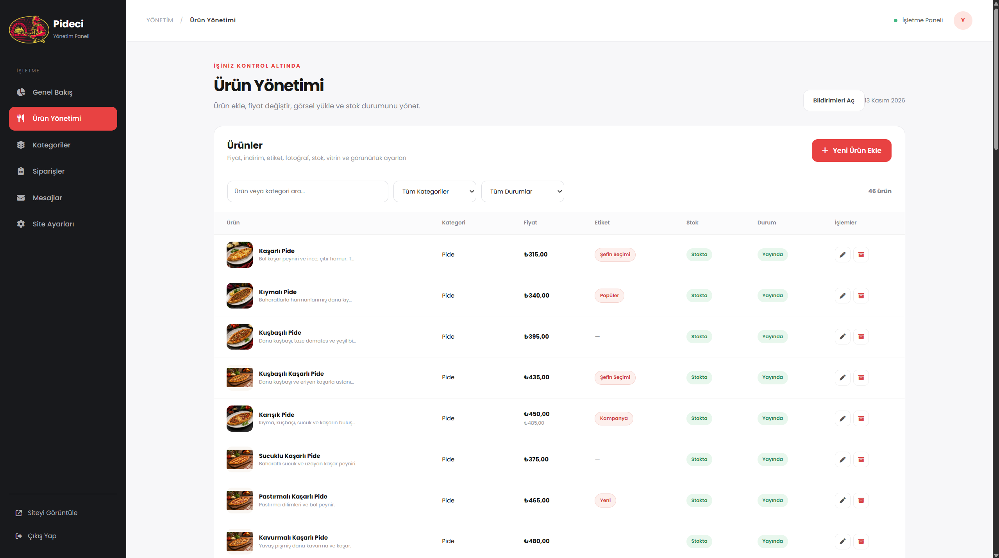 |

| Product Editor | Order Management |
|:---:|:---:|
| 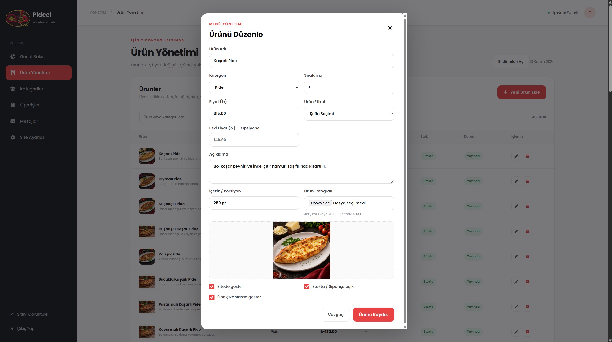 | 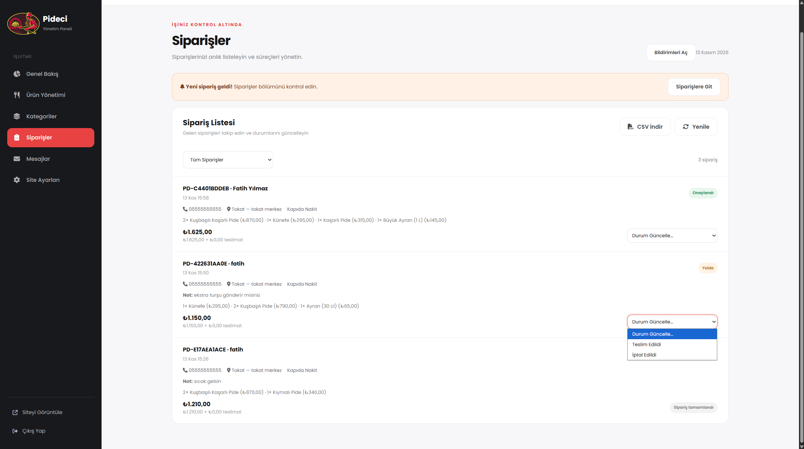 |

**Business Settings | İşletme Ayarları**

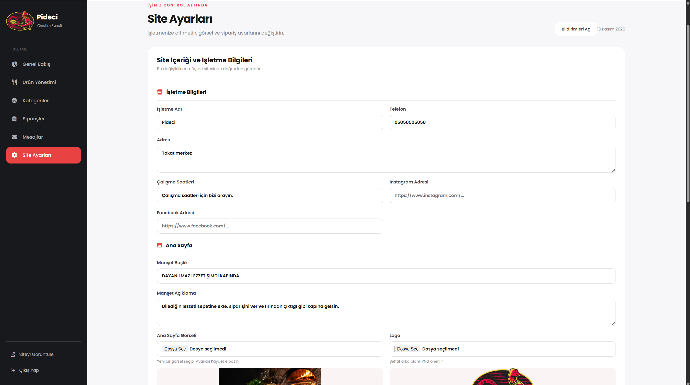

### Responsive Design | Mobil Arayüz

| Mobile Homepage | Mobile Menu | Mobile Cart |
|:---:|:---:|:---:|
| 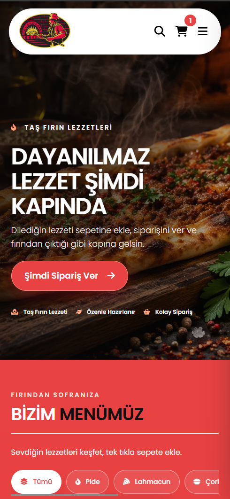 | 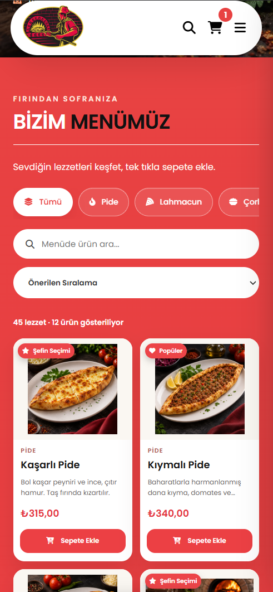 | 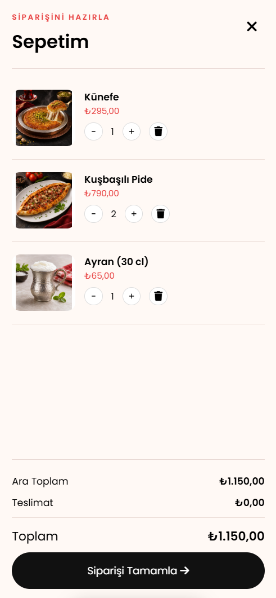 |

<!-- PIDECI_GALLERY_END -->
